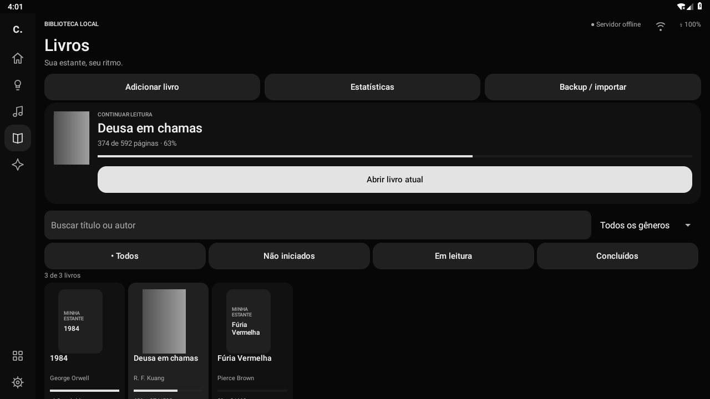
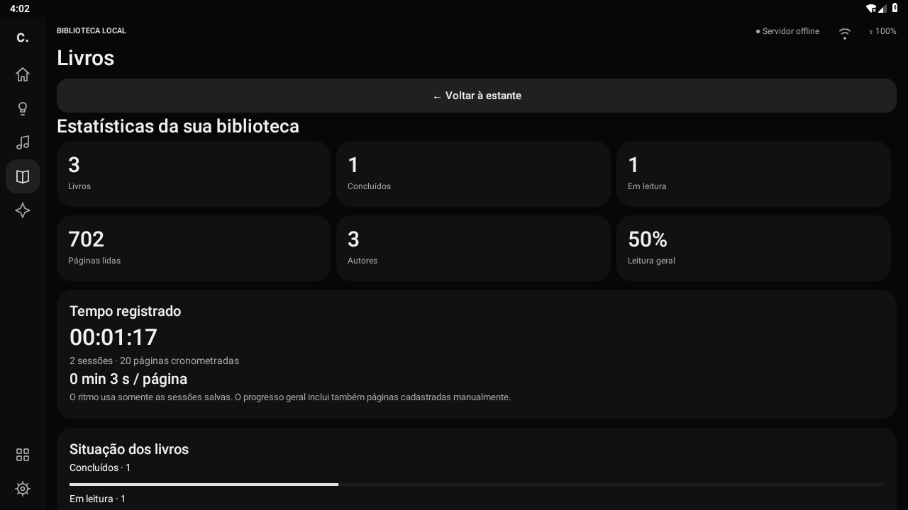
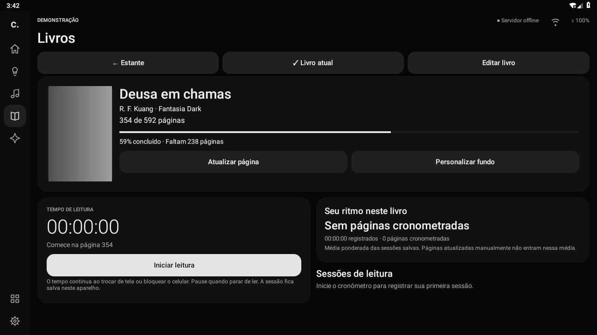
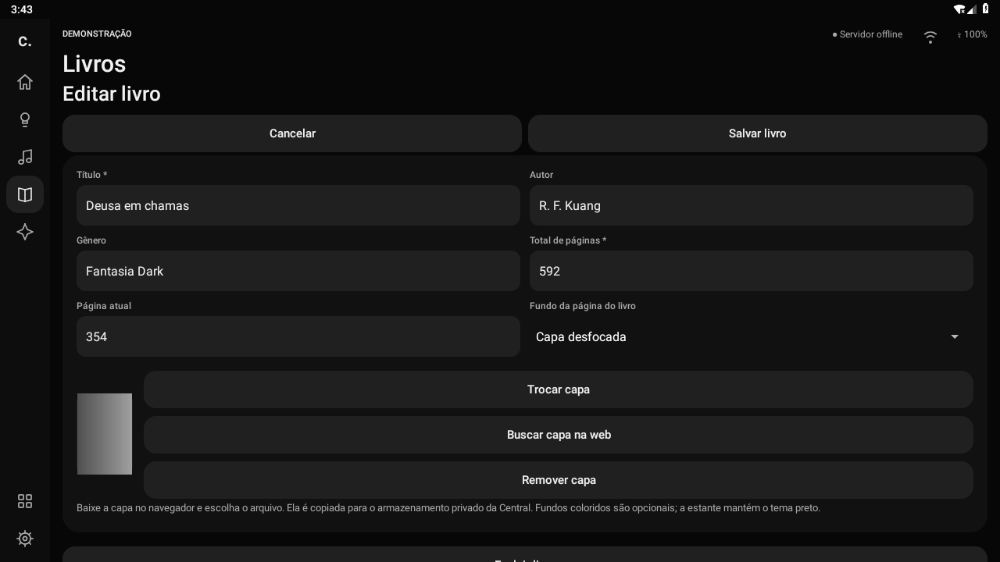
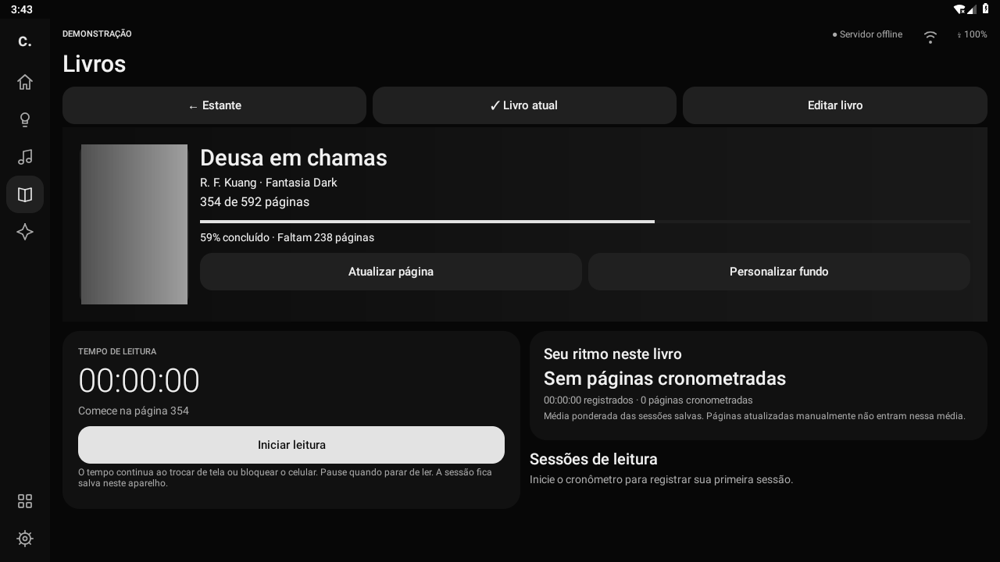
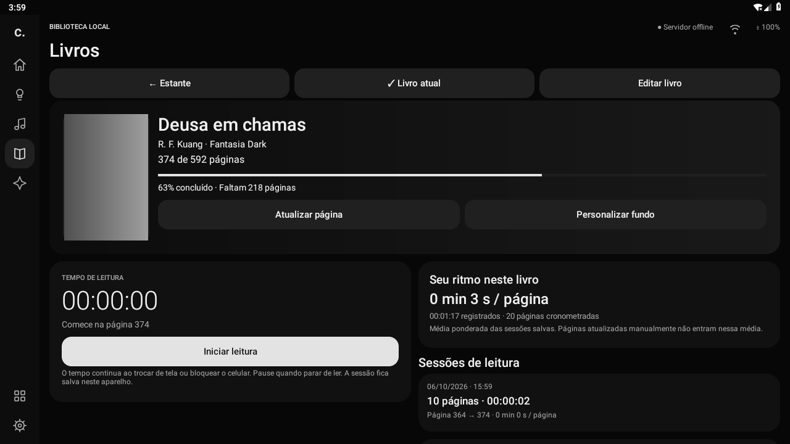

# Validação da biblioteca 0.3.0

Build com JDK 21, Gradle 8.9, AGP 8.7.3, compile/target API 35 e min API 21:

```sh
./gradlew --no-daemon assembleDebug assembleDebugAndroidTest testDebugUnitTest lintDebug
```

Oito testes JVM (quatro já existentes e quatro novos) cobrem estado dos services, reconexão, validação de livro/sessão, cronômetro monotônico, pausa/retomada, reinício e média ponderada, incluindo zero páginas. O lint não apresentou erros; mantém avisos de APIs de orientação, acessibilidade do gate administrativo e strings em código na interface ainda não localizada.

## Banco e JSON em Android real do emulador

A instrumentação própria, sem dependências extras, executa contra SQLite e org.json do Android API 28 em `library-validation.db`, separado da biblioteca da UI:

```sh
adb install -r app/build/outputs/apk/debug/app-debug.apk
adb install -r app/build/outputs/apk/androidTest/debug/app-debug-androidTest.apk
adb shell am instrument -w br.com.centralcasa.test/br.com.centralcasa.books.LibraryInstrumentation
```

O runner retorna `PASS` e código de instrumentação -1; em falha retorna `FAIL`, stack trace e código 0. É um runner de verificação de cenários, não um adaptador JUnit para relatório do connectedAndroidTest. O código e os relatórios de teste não acompanham o APK principal.

Cenários: persistir e reabrir banco; pausar/recuperar draft; salvar sessão e atualizar página atomicamente; editar livro preservando sessões; impedir segundo cronômetro; recusar finalização com página menor; exportar e reimportar livros/capa/sessões; gerar miniatura e fundo com blur; não duplicar sessões na reimportação; IDs estáveis em JSON legado; rollback de importação após uma alteração válida seguida de conflito com histórico existente; rejeitar progresso inválido; excluir livro com cascade das sessões.

## Interface nativa

O teste adicional `adb shell am instrument -w -e verifyUi true br.com.centralcasa.test/br.com.centralcasa.books.LibraryInstrumentation` usa a biblioteca de exemplo já inserida no emulador. Aciona os controles nativos, informa a página final por acessibilidade (sem depender do teclado do emulador), salva a sessão e confere página, média e histórico, edição sem perda de sessões, estatísticas, fundo de capa e acesso às configurações do Android. Não deve ser executado sobre uma biblioteca pessoal: cria uma sessão de teste no livro atual.

A recuperação da sessão após `am force-stop` foi também conferida pela UI: o contador continuou no mesmo boot. Após reiniciar o emulador por falha do sistema, o último checkpoint voltou pausado, conforme previsto.

O seletor real de documentos também foi exercitado: exportação para Downloads gerou JSON UTF-8 com três livros, duas sessões e capa JPEG embutida; o mesmo arquivo foi selecionado e reimportado pela interface, retornando à estante com três livros, sem duplicações. Isso verifica o caminho Activity result → executor → banco, além do codec isolado.

## Conferência visual

Capturas da UI Android em landscape 1280×720, com três livros de exemplo inseridos **somente no emulador** por opção explícita do APK de instrumentação. A capa cinza é uma imagem sintética de teste, não a capa recuperada dos prints. A biblioteca de uma instalação nova começa vazia. Não se importaram os 159 livros do usuário.













A conta de tempo por página foi também verificada pelos modelos e no SQLite. Conferir as capturas não comprova desempenho ou consumo no Redmi. Emulador sem KVM usa renderização por software e pode atrasar frames ou o serviço de automação do Android; tempos dele não são atribuídos ao aparelho físico. Durante entrada pelo teclado, o sistema do emulador caiu com `FinalizerWatchdogDaemon: SurfaceControl.finalize() timed out`, seguido de `DeadSystemException` em `com.android.phone`. O erro foi do processo do sistema, sem exceção da Central nessa captura; o emulador foi reiniciado para continuar as verificações. Isso não demonstra comportamento no Redmi.

## Limites

Não foram executados no Redmi: compatibilidade com MIUI, acesso às telas do sistema, consumo, comportamento após reinício físico e seletor de arquivos do fabricante. Android 5/6 têm recuperação conservadora do timer descrita em [LIBRARY.md](LIBRARY.md). Não existe servidor nem sincronização. Na 0.3.1, o JSON original enviado foi validado em teste de migração separado; veja [MIGRATION.md](MIGRATION.md). Formatos diferentes ainda exigem adaptação.
